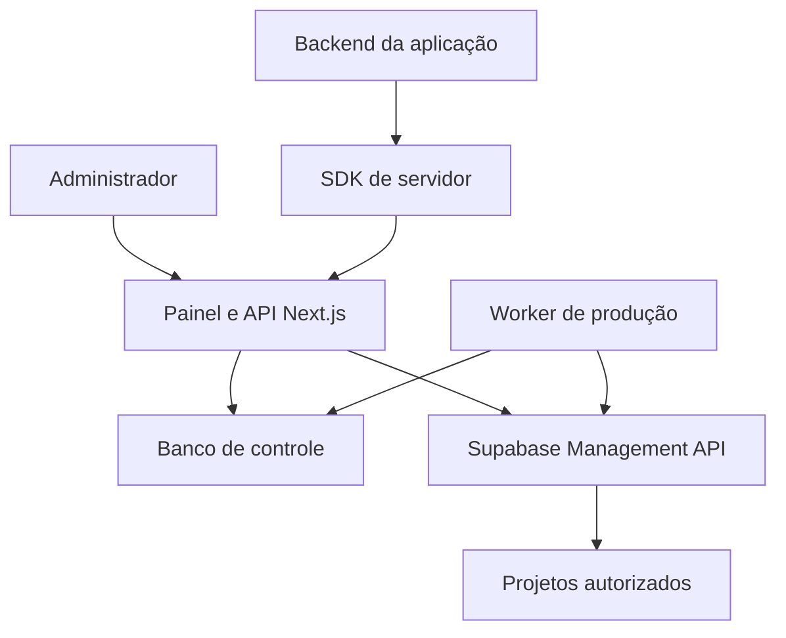
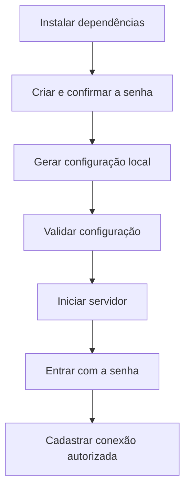
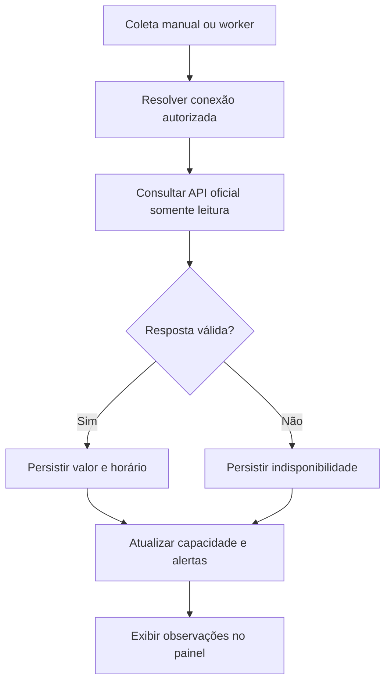
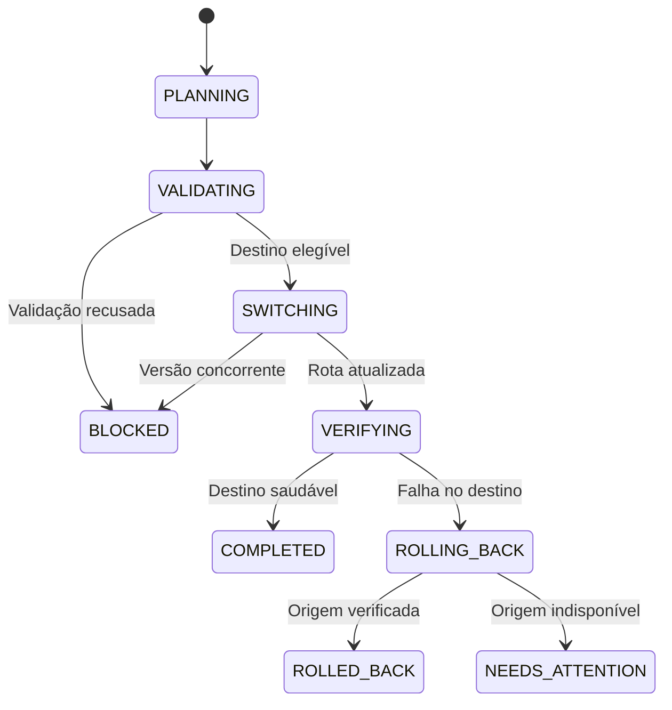
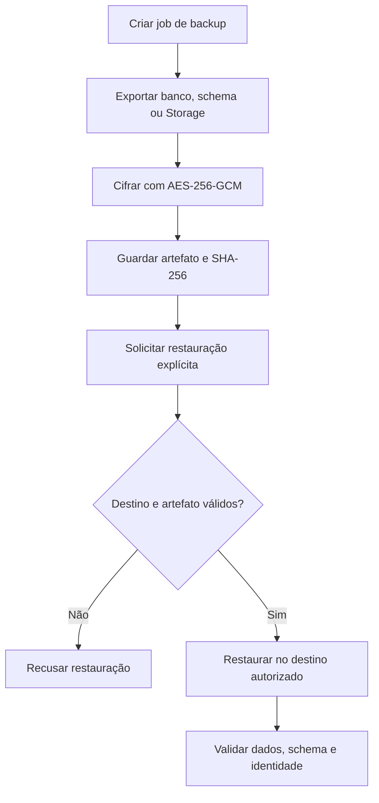

# Supabase Control Hub

**Um painel para inventário, capacidade, backups e rotas de aplicações que usam Supabase.**

O Control Hub reúne conexões autorizadas, organizações e projetos em um workspace administrativo. Ele coleta observações reais, acompanha limites com abrangência explícita e planeja a troca do projeto utilizado por uma aplicação, com validações e rollback.

O banco de controle é independente dos projetos monitorados. A alternância atualiza uma rota versionada; ela não copia tabelas, replica dados nem migra sessões do Supabase Auth.

Métricas indisponíveis aparecem como **Não monitorado**; o painel não apresenta valores simulados como se fossem medições reais.

## Navegação

- [Recursos e estado atual](#recursos-e-estado-atual)
- [Arquitetura](#arquitetura)
- [Instalação local](#instalação-local)
- [Configuração](#configuração)
- [Primeira conexão](#primeira-conexão)
- [Coleta e capacidade](#coleta-e-capacidade)
- [Alternância e rollback](#alternância-e-rollback)
- [Backups e restauração](#backups-e-restauração)
- [SDK de servidor](#sdk-de-servidor)
- [Integração MCP](#integração-mcp)
- [Produção com Docker](#produção-com-docker)
- [Comandos](#comandos)
- [Testes e validação](#testes-e-validação)
- [Estrutura do projeto](#estrutura-do-projeto)
- [Limitações e próximos passos](#limitações-e-próximos-passos)
- [Solução de problemas](#solução-de-problemas)
- [Documentação técnica](#documentação-técnica)

## Recursos e estado atual

| Área | O que está implementado |
| --- | --- |
| Acesso administrativo | Login com senha, hash scrypt, sessão HttpOnly de oito horas e controle de tentativas |
| Conexões | PAT, credenciais cifradas, ativação, desativação e rotação de token |
| OAuth | Fluxo com PKCE e estado de uso único; depende de aplicativo registrado no Supabase |
| Inventário | Descoberta por conexão, organizações e projetos com identidade global |
| Projetos compartilhados | Um projeto pode ser acessível por várias conexões sem duplicar sua identidade |
| Métricas | Tamanho do PostgreSQL e arquivos Storage por consultas oficiais somente leitura |
| Capacidade | Limites com fonte, unidade, categoria, abrangência e período |
| Alertas | Histórico persistente; dados ausentes não encerram alertas anteriores |
| Resource Explorer | Agrupamento por conta, organização, projeto ou aplicação e histórico observado |
| Aplicações | Pools de projetos, prioridades, políticas de continuidade e rota versionada |
| Schemas | Snapshots, fingerprint e comparação de estrutura, políticas e permissões |
| Failover | Planejamento, revalidação, bloqueios, troca de rota, verificação e rollback |
| Backups | Exportação de banco/schema/Storage, AES-256-GCM, SHA-256 e retenção |
| Auditoria | Registro de operações administrativas, backups e alternâncias |
| Integrações | SDK de servidor e ferramentas MCP somente leitura |

A implementação possui testes locais com PGlite real e respostas Supabase simuladas. Integrações externas, restaurações reais e implantação ainda exigem validação em projetos de teste autorizados. Veja [os resultados executados](docs/TEST_RESULTS.md).

## Arquitetura

### Componentes



| Componente | Tecnologia e responsabilidade |
| --- | --- |
| Interface | Next.js 16, React 19, TypeScript, Tailwind CSS 4 e Lucide |
| API | Route Handler no runtime Node.js, validação Zod e verificações de origem |
| Persistência | Drizzle com PostgreSQL em produção ou PGlite no desenvolvimento |
| Integração Supabase | Management API oficial e SDK oficial de Storage |
| Worker | Coleta, alertas, avaliação por capacidade, jobs e retenção |
| Segurança | scrypt, AES-256-GCM, cookies HttpOnly, rate limiting e auditoria |

O painel consulta somente os projetos alcançados por conexões autorizadas. O PostgreSQL de controle guarda inventário, observações, limites, rotas, sessões e jobs; ele não é uma réplica dos bancos monitorados.

### Desenvolvimento e produção

| Modo | Banco de controle | Execução |
| --- | --- | --- |
| Local | PGlite em `.data/postgres` | Um servidor; coleta acionada pelo painel |
| Produção | PostgreSQL independente | Web e worker separados, com HTTPS e volume compartilhado de backups |

O PGlite deve ter um único processo proprietário. Não inicie um worker independente apontando para o banco embarcado.

## Instalação local

### Requisitos

- Node.js 22 ou superior e npm.
- Acesso ao registro npm para instalar as dependências.
- Navegador atualizado.
- Uma conta Supabase e um PAT autorizado, quando for conectar projetos.

### Terminal

```powershell
git clone https://github.com/melinskyRf/supabase-control-hub.git
cd supabase-control-hub
npm ci
npm run setup
npm run dev
```

Abra **http://127.0.0.1:3000**.

O setup solicita uma senha de **14 a 256 caracteres**, digitada de forma oculta, e pede que ela seja repetida. Ele gera o hash da senha, a chave de criptografia e o token de leitura em `.env.local`. O login administrativo usa somente a senha; não exige código de autenticador.

O setup não sobrescreve uma configuração existente. Preserve a chave de criptografia: credenciais e backups já cifrados dependem dela.

### Duplo clique no Windows

| Arquivo | Função |
| --- | --- |
| `INICIAR.cmd` | Verifica Node.js e dependências, conduz o primeiro acesso quando necessário e inicia o servidor |
| `CONFIGURAR.cmd` | Executa o cadastro e a verificação de configuração sem abrir outro servidor |
| `VALIDAR.cmd` | Executa diagnóstico, tipos, testes e build, interrompendo no primeiro erro |

As janelas mantêm os erros visíveis. O projeto não exige execução como administrador.

O comando `npm run dev` usa a API oficial de servidor do Next.js, escuta apenas em `127.0.0.1:3000` e usa threads para os workers de desenvolvimento. A inicialização padrão do Next continua disponível em `npm run dev:standard`. Produção usa o fluxo normal de build e start.

### Fluxo do primeiro acesso



## Configuração

Use [.env.example](.env.example) como referência. O comando abaixo verifica a configuração sem imprimir os valores secretos:

```powershell
npm run check:config
```

| Variável | Uso | Como configurar |
| --- | --- | --- |
| `HUB_ORIGIN` | Origem esperada nas mutações | `http://127.0.0.1:3000` localmente; HTTPS em produção |
| `HUB_ENCRYPTION_KEY` | Chave AES de 32 bytes em hexadecimal | Gerada pelo setup; mantenha cópia segura |
| `ADMIN_PASSWORD_HASH` | Hash scrypt da senha administrativa | Gerado pelo setup |
| `AGENT_READ_TOKEN` | Autenticação das consultas MCP | Gerado pelo setup |
| `DATABASE_URL` | PostgreSQL de controle independente | Obrigatório em produção e para worker separado |
| `SUPABASE_OAUTH_CLIENT_ID` | Identificador do aplicativo OAuth | Opcional; exige aplicativo registrado |
| `SUPABASE_OAUTH_CLIENT_SECRET` | Segredo do aplicativo OAuth | Opcional; necessário junto do identificador |
| `PG_DUMP_PATH` | Executável para exportação PostgreSQL | Necessário para backups de banco/schema |
| `PG_RESTORE_PATH` | Executável para restauração PostgreSQL | Necessário para restaurar banco/schema |
| `BACKUP_DIRECTORY` | Diretório dos artefatos cifrados | Padrão: `backups` |
| `HUB_DATA_DIR` | Diretório do PGlite | Opcional no desenvolvimento |
| `POSTGRES_PASSWORD` | Senha do PostgreSQL do Compose | Variável do terminal ou do ambiente do Docker Compose |

PATs, credenciais de Storage e URLs PostgreSQL dos projetos são cadastrados no servidor pelo painel. Não coloque segredos em variáveis `NEXT_PUBLIC_*`, exemplos publicados ou código do navegador.

O repositório contém apenas o modelo de ambiente. Credenciais locais, bancos, sessões e artefatos de backup ficam fora do Git.

## Primeira conexão

1. Em **Accounts**, cadastre nome, identificador da conta e um PAT com as permissões necessárias.
2. Clique em **Descobrir projetos**. O inventário daquela conexão é reconciliado sem apagar projetos compartilhados com outras conexões.
3. Em **Projects**, use o cadastro manual para informar a chave publicável e o ambiente do projeto.
4. Acione **Coletar** para registrar banco e Storage, conforme as permissões disponíveis.
5. Em **Capacity Manager**, cadastre os limites com fonte, categoria e abrangência corretas.
6. Em **Applications**, cadastre uma aplicação e seu projeto inicial. Guarde o token de máquina retornado; ele é exibido uma vez.
7. Configure os membros do pool, prepare schemas e dados dos destinos e planeje a alternância antes de confirmá-la.

Para OAuth, registre o aplicativo no Supabase e configure as duas variáveis correspondentes. O botão de OAuth só é habilitado quando identificador e segredo estão presentes.

## Coleta e capacidade

### Como uma medição chega ao painel



Um valor ausente, nulo, vazio ou inválido não vira zero. **Zero só é uma medição quando a fonte o retorna explicitamente.**

### Abrangência dos limites

| Escopo | Aplicação |
| --- | --- |
| `PROJECT_LEVEL` | Um projeto específico |
| `ORGANIZATION_LEVEL` | Uma cota compartilhada por organização |
| `ACCOUNT_LEVEL` | Limite de conta; exige avaliação administrativa antes da troca |
| `APPLICATION_POLICY` | Política da aplicação; exige avaliação administrativa antes da troca |

Cotas de organização são contadas uma vez. Uma visão de conta ou aplicação não recebe uma cota compartilhada inteira quando inclui apenas parte dos projetos daquela organização. Os grupos são visões independentes e não devem ser somados entre si.

Transferência mensal usa um período explícito `YYYY-MM`. Observações de meses diferentes não são misturadas.

Os limites e seus percentuais de atenção, elevado e crítico são informados pelo administrador, com uma fonte identificada. O Hub não presume automaticamente a franquia de um plano Supabase.

## Alternância e rollback

A aplicação mantém uma rota com projeto ativo e versão. O executor valida o destino e usa a versão esperada para impedir uma troca baseada em um plano desatualizado.



### O que é verificado

| Critério | Comportamento |
| --- | --- |
| Autorização | Conexão ativa, membro habilitado e organização permitida |
| Saúde | Destino saudável com verificação recente |
| Schema | Snapshots recentes e estruturas compatíveis |
| Capacidade | Observações válidas e atuais; limites abaixo do nível crítico |
| Dados | Política independente ou atestado vigente de sincronização/restauração |
| Identidade | Requisitos específicos do modo de autenticação |
| Concorrência | Operação única em andamento e atualização por versão |
| Controle | Aplicação sem bloqueio administrativo e cooldown respeitado |

Saúde e capacidade exigem observações de até **180 segundos**; snapshots de schema, até **300 segundos**. O cooldown padrão é de **900 segundos**.

Na troca manual, use a versão retornada pelo planejamento e a confirmação `SWITCH PROJECT_REF`. Após alterar a rota, o Hub verifica o destino. Se ele falhar, tenta retornar à origem; a rota só é liberada quando a verificação permite isso.

As automações começam pausadas e exigem PostgreSQL externo e worker. O gatilho implementado é capacidade crítica de banco/Storage, não indisponibilidade genérica. Quando o gatilho é uma cota de organização, o destino automático precisa estar em outra organização.

Supabase Auth bloqueia a alternância porque identidades e sessões são específicas do projeto. Não há migração transparente de sessões, transações ou canais Realtime. O Hub também não controla clientes que continuam usando uma URL Supabase diretamente.

Detalhes de atestados, recuperação assistida e estados de erro: [docs/FAILOVER.md](docs/FAILOVER.md).

## Backups e restauração

| Tipo | Exportação | Requisito |
| --- | --- | --- |
| `database` | Dump PostgreSQL em formato custom | URL PostgreSQL autorizada e `pg_dump` compatível |
| `schema` | Dump somente de estrutura | Mesmos requisitos da exportação PostgreSQL |
| `storage` | Manifesto de buckets e objetos em JSONL | Credencial explícita de Storage |



Os artefatos usam extensão `.hub`, digest SHA-256 e metadados de job. Um download cifrado não pode ser entregue diretamente ao `pg_restore`. A importação integrada verifica a integridade e autentica o artefato antes de aplicá-lo.

A restauração exige `RESTORE PROJECT_REF` e validação do destino. Banco/schema usam restauração transacional; Storage exige ausência de buckets com os mesmos IDs e não sobrescreve objetos. Uma falha de rede no Storage pode deixar uma importação parcial, que precisa de revisão antes de nova tentativa.

A retenção padrão é de **30 dias**, processada pelo worker. Backups agendados exigem PostgreSQL externo e worker; no modo local, backups manuais são executados pelo processo web.

A exportação de Storage suporta até **100 mil objetos** e **64 MB por arquivo**. A chave de criptografia e os metadados do banco de controle precisam ser preservados junto da estratégia de recuperação.

Veja [docs/BACKUP.md](docs/BACKUP.md) para requisitos de TLS, conexão e restauração.

## SDK de servidor

O SDK está em [src/sdk/index.ts](src/sdk/index.ts). Ele deve ser integrado ao **backend** da aplicação.

```typescript
import { controlHub } from './src/sdk/index';

const hub = controlHub({
  origin: process.env.HUB_ORIGIN!,
  applicationId: process.env.HUB_APPLICATION_ID!,
  machineToken: process.env.HUB_MACHINE_TOKEN!,
});

const result = await hub.run(client =>
  client.from('products').select('*')
);
```

Configure as variáveis no backend consumidor. O identificador e o token de máquina são obtidos ao cadastrar a aplicação no Hub.

Resolva a rota a cada operação usando `run`. Reter um cliente antigo ignora verificações posteriores de rota. O SDK recria o cliente quando a versão muda, permite tratamento por `onRouteChange` e interrompe o uso quando a rota não pode ser resolvida.

O token de máquina não deve ser publicado em um bundle do navegador.

## Integração MCP

O servidor MCP permite consultar o Hub por stdio, com um token separado de leitura. Ele não executa alternâncias nem restaurações.

```json
{
  "mcpServers": {
    "control-hub": {
      "command": "npm",
      "args": ["run", "--silent", "mcp"],
      "cwd": "CAMINHO_ABSOLUTO_DO_PROJETO"
    }
  }
}
```

O servidor web deve estar em execução, com `HUB_ORIGIN` e `AGENT_READ_TOKEN` configurados em `.env.local`.

| Ferramenta | Consulta |
| --- | --- |
| `hub_overview` | Inventário e estado geral |
| `hub_projects` | Projetos únicos e saúde |
| `hub_capacity` | Capacidade agregada por categoria |
| `hub_resource_groups` | Consumo agrupado por conta, organização e aplicação |
| `hub_health` | Saúde, autorização e atualização das observações |
| `hub_alerts` | Alertas persistidos |
| `hub_backups` | Histórico dos backups |
| `hub_activity` | Auditoria e operações |

Contratos HTTP e ações administrativas: [docs/API.md](docs/API.md).

## Produção com Docker

A configuração de produção usa três serviços: **postgres**, **web** e **worker**. Web e worker compartilham um volume para os backups cifrados.

1. Gere a configuração com `npm run setup`.
2. Ajuste `HUB_ORIGIN` em `.env.local` para a origem HTTPS do painel.
3. Configure `POSTGRES_PASSWORD` no ambiente do Compose. Use uma senha compatível com a URL de conexão ou faça a codificação apropriada.
4. Suba os serviços:

```powershell
$env:POSTGRES_PASSWORD = 'SUBSTITUA_POR_UMA_SENHA_FORTE_COMPATIVEL_COM_URL'
docker compose up --build -d
```

O Compose define a conexão do banco de controle para web e worker e publica a porta web somente em localhost. Configure um proxy HTTPS e acesso privado ao painel. Cookies de produção exigem HTTPS.

O cliente PostgreSQL instalado na imagem precisa ser compatível com o servidor que será exportado. Atualize a imagem se a origem exigir uma versão mais recente de `pg_dump`.

O repositório público distribui o código; ele não publica automaticamente uma instância do painel nem inclui credenciais de nenhuma conta Supabase.

## Comandos

| Comando | Finalidade |
| --- | --- |
| `npm run setup` | Cadastrar senha e gerar configuração local |
| `npm run check:config` | Validar a configuração sem mostrar segredos |
| `npm run dev` | Iniciar desenvolvimento local em um processo |
| `npm run dev:standard` | Usar o iniciador padrão do Next.js |
| `npm run diagnose` | Verificar dependências e criação de subprocessos |
| `npm run typecheck` | Verificar TypeScript |
| `npm run test:core` | Executar a suíte central com Node |
| `npm run test:smoke` | Executar integração local com PGlite real |
| `npm test` | Executar Vitest |
| `npm run test:e2e` | Executar Playwright |
| `npm run build` | Gerar build de produção |
| `npm start` | Iniciar a aplicação após o build |
| `npm run worker` | Executar worker com PostgreSQL externo |
| `npm run mcp` | Executar o servidor MCP de leitura |

## Testes e validação

```powershell
node tests/core.test.mjs
npm run typecheck
npm run test:smoke
npm test
npm run build
npx playwright install chromium
npm run test:e2e
```

| Verificação local registrada | Resultado |
| --- | --- |
| Suíte central | 16 testes aprovados |
| Integração com PGlite e handlers reais | 8 testes aprovados |
| TypeScript | Aprovado |
| Login somente com senha e navegação real | Verificados |
| Vitest | Bloqueado no executor utilizado por `spawn EPERM` |
| Build completo | Compilação avançou; subprocesso da etapa TypeScript foi bloqueado |
| Suíte Playwright | Worker de testes bloqueado por `spawn EPERM` |

Os testes de integração usam banco embarcado e arquivos cifrados reais, com respostas Supabase simuladas. Não foram conectados projetos de produção nem realizadas restaurações externas durante essa validação.

A compilação parcial não equivale a um build de produção aprovado. Repita os comandos em um ambiente que permita os subprocessos necessários. O diagnóstico está em [docs/TEST_RESULTS.md](docs/TEST_RESULTS.md).

## Estrutura do projeto

| Caminho | Conteúdo |
| --- | --- |
| `src/app` | Interface, estilos e endpoints HTTP |
| `src/core` | Capacidade, alertas, segurança, configuração e elegibilidade |
| `src/server` | Banco de controle, autenticação, Supabase, schemas, motor e backups |
| `src/sdk` | Resolução de rotas no backend consumidor |
| `scripts` | Setup, desenvolvimento, diagnóstico, worker e MCP |
| `tests` | Testes centrais, integração e navegador |
| `docs` | Arquitetura, API, segurança, continuidade e recuperação |
| `compose.yaml` | PostgreSQL, aplicação web e worker |
| `Dockerfile` | Imagem Node.js com cliente PostgreSQL |
| `.env.example` | Modelo de variáveis sem valores secretos |

## Limitações e próximos passos

- CPU, RAM, tráfego e requisições de API permanecem sem medição quando não existe coletor configurado. Não são apresentados como consumo zero.
- Cotas de conta e políticas de aplicação exigem avaliação administrativa antes da troca.
- O Hub não replica dados, não prepara schemas do destino e não migra Supabase Auth.
- A avaliação automática é baseada em capacidade crítica de banco/Storage e depende do worker.
- OAuth precisa de aplicativo registrado e permissões corretas.
- Notificações externas, armazenamento remoto de backups e coletores adicionais ainda precisam de implementação/configuração.
- Ensaios de concorrência entre processos, falhas prolongadas e restauração real ainda precisam de ambientes de teste autorizados.
- O acesso administrativo atual usa uma única senha; não há gestão de múltiplos administradores ou papéis pelo painel.

## Solução de problemas

| Sintoma | Verificação |
| --- | --- |
| A página não abre | Confirme `Ready: http://127.0.0.1:3000` no terminal e mantenha o servidor aberto |
| A porta 3000 está ocupada | Encerre a outra instância antes de iniciar o Hub |
| A página mostra primeiro acesso | Execute `npm run check:config`; configure o acesso e recarregue a página |
| O setup informa arquivo existente | Preserve `.env.local` e a chave de criptografia; não gere outra configuração por cima |
| Uma operação retorna erro de origem | A URL usada no navegador deve corresponder a `HUB_ORIGIN` |
| Uma métrica está indisponível | Verifique permissões do PAT, saúde do projeto e disponibilidade da consulta oficial |
| A alternância foi bloqueada | Leia os motivos do planejamento: capacidade, schema, identidade, dados e versão |
| O worker não inicia com PGlite | Use PostgreSQL externo para execução separada |
| `spawn EPERM` nos testes/build | Execute o diagnóstico e valide em um ambiente que permita subprocessos e seus canais |
| O backup PostgreSQL falha | Confira URL do projeto, TLS, permissões e versão de `pg_dump`/`pg_restore` |

## Documentação técnica

- [Arquitetura e decisões](docs/ARCHITECTURE.md)
- [API, SDK e MCP](docs/API.md)
- [Segurança operacional](docs/SECURITY.md)
- [Alternância e continuidade](docs/FAILOVER.md)
- [Backups e restauração](docs/BACKUP.md)
- [Estado da implementação](docs/STATUS.md)
- [Resultados dos testes](docs/TEST_RESULTS.md)

Integrações oficiais utilizadas: [Supabase Management API](https://supabase.com/docs/reference/api/introduction), [tokens de acesso](https://supabase.com/docs/guides/platform/personal-access-tokens), [OAuth](https://supabase.com/docs/guides/integrations/build-a-supabase-oauth-integration) e [servidor Next.js](https://nextjs.org/docs/app/guides/custom-server).

